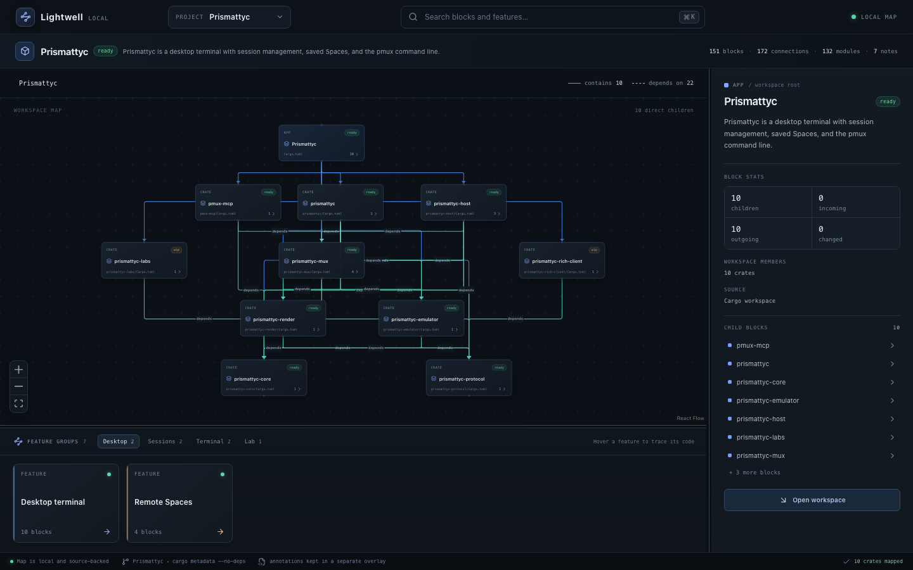
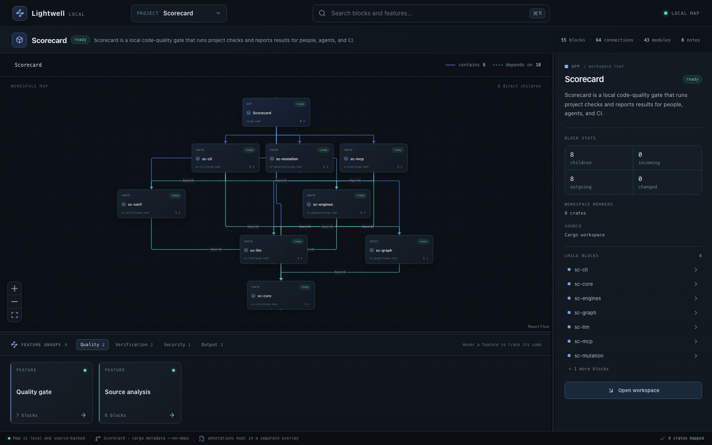

# Lightwell

turning the lights on in the Dark Factory

Lightwell maps Rust workspaces, TypeScript, JavaScript, HTML and CSS projects (including React and Next.js), Python modules, Go packages, and C# and VB.NET projects. It shows crates, app entry points, Rust modules, web, Python, Go, and .NET modules, imports, top-level classes and functions, Cargo features, dependency edges, and written product notes. The checked-in preview maps cover Prismattyc and Scorecard. Extracted facts and preview notes live in separate JSON files.

## Install

Lightwell v0.1.16 is available for macOS (Apple Silicon and Intel), Linux x86_64 and ARM64, and Windows x64 from [GitHub Releases](https://github.com/moonbase2090/lightwell/releases) and [getlightwell.app](https://getlightwell.app/). Checksums are in [`SHA256SUMS`](https://github.com/moonbase2090/lightwell/releases/latest/download/SHA256SUMS).

### macOS

Download [`Lightwell_0.1.16_aarch64.dmg`](https://github.com/moonbase2090/lightwell/releases/download/v0.1.16/Lightwell_0.1.16_aarch64.dmg) for Apple Silicon or [`Lightwell_0.1.16_universal.dmg`](https://github.com/moonbase2090/lightwell/releases/download/v0.1.16/Lightwell_0.1.16_universal.dmg) for Intel and Apple Silicon (macOS 11.0 or later). The disk images are signed with an Apple Developer ID and notarized by Apple. Open it and drag Lightwell to Applications.

### Linux

Download [`Lightwell_0.1.16_amd64.deb`](https://github.com/moonbase2090/lightwell/releases/download/v0.1.16/Lightwell_0.1.16_amd64.deb) (x86_64, glibc 2.28 or later) for Debian, Ubuntu, and other apt-based distributions, then install it:

```sh
sudo apt install ./Lightwell_0.1.16_amd64.deb
```

Other x86_64 distributions can use [`Lightwell_0.1.16_amd64.AppImage`](https://github.com/moonbase2090/lightwell/releases/download/v0.1.16/Lightwell_0.1.16_amd64.AppImage), [`Lightwell_0.1.16_x86_64.rpm`](https://github.com/moonbase2090/lightwell/releases/download/v0.1.16/Lightwell_0.1.16_x86_64.rpm) for Fedora, RHEL and openSUSE, or the portable [`Lightwell_0.1.16_linux_x86_64.tar.gz`](https://github.com/moonbase2090/lightwell/releases/download/v0.1.16/Lightwell_0.1.16_linux_x86_64.tar.gz), which unpacks to `lightwell/` with an `install.sh`. `packaging/arch/PKGBUILD` builds an Arch package from the tarball. For Linux on ARM64, [`Lightwell_0.1.16_linux_aarch64.tar.gz`](https://github.com/moonbase2090/lightwell/releases/download/v0.1.16/Lightwell_0.1.16_linux_aarch64.tar.gz) carries the command line tool.

### Windows

Download [`Lightwell_0.1.16_x64.msi`](https://github.com/moonbase2090/lightwell/releases/download/v0.1.16/Lightwell_0.1.16_x64.msi) (x64) and run it to install Lightwell.

### Updates

The signed macOS disk image, the Windows MSI, and the Linux AppImage check for updates. The check is on by default. Settings can turn it off, and **Check now** looks immediately. When an update is available, Lightwell shows the release notes. On those three install types, **0.1.14 and later** can install a signed update in the app; other installs still open download links. Tagged releases sign updater payloads and publish `latest.json` when the `TAURI_SIGNING_PRIVATE_KEY` repository secret is configured; the release workflow fails if that secret is missing.

The Debian package, the RPM, and the Linux tarball cannot replace themselves. Those installs still check, show the notes, and link to the [latest release](https://github.com/moonbase2090/lightwell/releases/latest).

### From source

Build Lightwell from this repository. The viewer needs Node.js 22. The command line and desktop app need a stable Rust toolchain.

#### Browser preview

```sh
git clone https://github.com/moonbase2090/lightwell.git
cd lightwell
npm ci
npm run dev
```

Open the local address Vite prints. The preview loads the checked-in maps and does not make network requests.

Settings saves three text sizes on this device: UI text, source code, and tree and map labels. Kind badges, the header strip, and the block and connection counts use a larger default size.

`npm run build` writes the static site to `dist/`.

#### Command line

From the clone:

```sh
cargo install --path crates/lightwell-cli
lightwell extract . --name Lightwell -o /tmp/lightwell-map.json
```

#### Desktop app

The desktop shell is a [Tauri](https://v2.tauri.app/) v2 app around the same viewer. Install the [Tauri prerequisites](https://v2.tauri.app/start/prerequisites/) for your system, then from the clone:

```sh
npm ci
npm run tauri:dev
```

`npm run tauri:build` writes a local bundle.

#### Windows package

On Windows, with Node.js 22, a stable Rust toolchain, and WiX 5.0.2:

```powershell
powershell -File scripts/release/build-windows.ps1
```

The script installs WiX 5.0.2 for the current user when `wix` is not already on `PATH`. It writes a per-user MSI. `Lightwell.exe` is the desktop app. `bin\lightwell.exe` is the command line tool. The install adds that `bin` directory to the user `PATH`; pass `ADDTOPATH=0` to msiexec to skip it. Uninstall removes the entry. The script does not sign. Tagged releases sign `Lightwell.exe`, `bin\lightwell.exe`, and the MSI with Azure Artifact Signing in the release workflow. A local build prints `Windows code signing skipped: Azure Artifact Signing settings are absent.`

## Screenshots

Checked-in Prismattyc preview:



Checked-in Scorecard preview:



## Privacy

Maps, project notes, and editor settings stay on your machine. See [PRIVACY.md](PRIVACY.md).

## Desktop shell

Releases ship signed and notarized Apple Silicon and universal `.dmg` images, an x86_64 Linux `.deb` built for a glibc 2.28 executable floor, an AppImage, an rpm, Linux tarballs for x86_64 and ARM64, and a Windows MSI. See [Install](#install).

In the desktop app, choose **Open workspace** and select a folder with a `Cargo.toml`. Recent workspaces are kept in Lightwell's user config folder, outside the project. The browser preview continues to use the checked-in Prismattyc and Scorecard fixtures.

The workspace map has a **Modules** / **Files** toggle. Modules shows the module map. **Files** opens an explorer-style vertical tree with a filter box, **Expand all** and **Collapse**, and an inspector for the selected file or folder. Each row shows the path and child count beside the name. **−**, the percentage, and **+** zoom that tree; the percentage resets it. Ctrl or Cmd with +, −, or 0 do the same. Lightwell saves the zoom per workspace. A rotate control on the toolbar switches to the horizontal graph layout; Lightwell saves the orientation per workspace and defaults to vertical. A **Depth** control sets how many levels the map draws in Modules and Files views, from 1 to the full tree. Lightwell saves depth per workspace.

Use the commit picker (**Through** and optional **Since**) to highlight blocks and connections that changed across a commit or range, with line counts on changed blocks and a side-by-side diff in the source inspector. In the source view, right-click a line or press **Alt+Z** to turn word wrap on or off.

Project notes are on in default and release builds. To omit the notes commands and leave the dialog unwired, set:

```sh
VITE_ENABLE_PROJECT_NOTES=false npm run tauri:build
```

Right-click a block (or press Shift+F10), use **Add note** in the details panel, press **N**, or click **Notes** to add, edit, or remove notes for map blocks. The dialog reads and writes the opened project's `.lightwell/notes.json` file. It marks stale notes and keeps them until you remove them.

## Rust CLI

With `lightwell` installed from `crates/lightwell-cli`, you can refresh a checked-in preview from a sibling checkout. Extract a map with:

```sh
lightwell extract ../Prismattyc --name Prismattyc -o maps/prismattyc.facts.json
```

The Rust CLI calls `lightwell-core`. It uses `cargo metadata --no-deps` when Cargo is installed and otherwise reads the manifests and Rust sources directly. It records workspace crates, app targets, internal path dependencies, declared Cargo features, Rust modules, Python modules, Go modules, C# and VB.NET projects, and source fingerprints. Python support is on by default: `.py` and `.pyi` files in the workspace become modules, with their imports and top-level classes and functions. Go support is on by default when `go.mod` is present: packages, `.go` files, imports, and top-level functions, methods, and types. C# and VB.NET support is on by default: a solution or project file sets the project boundary, `.cs` and `.vb` files become namespace, type, and method blocks, and project references plus resolved type names become connections. A namespace with its opening brace on the next line is block-scoped. Type names keep non-ASCII characters, and each method overload keeps its own commit-diff span. It omits test-only Rust modules. Paths in each output file are relative to the source repository.

Run `watch` to stream a map and later maps when source fingerprints change:

```sh
lightwell watch ../Prismattyc --name Prismattyc
```

`lightwell watch` writes each complete map to stdout as JSON Lines. Press Ctrl-C to stop it.

CI builds and runs the Rust CLI on macOS with a macOS 11.0 deployment target. Linux CI builds x86_64 and ARM64 binaries with a glibc 2.28 symbol floor and runs each binary on Amazon Linux 2023.

The `npm run lightwell -- ...` command remains available for the TypeScript preview workflow while the app migrates to the shared Rust extractor.

## Open a block in an editor

Run `lightwell open <block-id>` from the workspace root. The command extracts the current map, finds the block source, and opens that file at the start. Schema v1 does not record source spans, so the CLI uses line 1 and column 1.

By default, Lightwell uses `open` on macOS, `xdg-open` on Linux, and `cmd /C start` on Windows. Set `LIGHTWELL_EDITOR_TEMPLATE` to override the OS handler. Templates accept `{file}`, `{line}`, and `{column}`. Lightwell parses the template into a program and arguments without evaluating it in a shell. If the configured command or OS handler fails, Lightwell tries `VISUAL`, then `EDITOR`.

```sh
LIGHTWELL_EDITOR_TEMPLATE='code --goto {file}:{line}:{column}' lightwell open crate:lightwell-core
```

These templates are examples, not a supported-editor list. Use any command available on your system.

| Editor | Template |
| --- | --- |
| JetBrains IDE | `idea --line {line} --column {column} {file}` |
| Kiro | `kiro {file}` |
| Zed | `zed {file}:{line}:{column}` |
| Visual Studio Code | `code --goto {file}:{line}:{column}` |
| Cursor | `cursor {file}` |
| Vim in a Linux terminal | `x-terminal-emulator -e vim "+call cursor({line},{column})" {file}` |

See the [JetBrains command-line reference](https://www.jetbrains.com/help/idea/opening-files-from-command-line.html), [Zed CLI reference](https://zed.dev/docs/reference/cli), and [Visual Studio Code CLI reference](https://code.visualstudio.com/docs/configure/command-line) for their documented file and location arguments.

## Preview notes

The checked-in preview uses one notes overlay for each map:

```sh
node scripts/seed-annotations.mjs maps/prismattyc.facts.json ../Prismattyc maps/prismattyc.annotations.json
node scripts/seed-annotations.mjs maps/scorecard.facts.json ../Scorecard maps/scorecard.annotations.json
```

The seed command refuses to overwrite an existing overlay. Edit the overlay to change a description, kind, status, feature membership, or feature group. Descriptions come from source documentation or the written project notes in the seeding script.

When a block's fingerprint no longer matches its note, the viewer marks it as changed. Review the block and update its `sourceFingerprint`. Update affected feature `sourceFingerprints` when their descriptions still match the source. Extraction never writes to note overlays.

## Project notes

Save project notes from the workspace root. Lightwell creates `.lightwell/notes.json` on the first save and stores each note by stable block ID with the source fingerprint it describes.

```sh
lightwell extract . -o /tmp/lightwell-map.json
lightwell notes set crate:lightwell-core "Review output serialization"
lightwell notes list
lightwell notes rm crate:lightwell-core
```

Use a `blocks[].id` value from the extracted map. `notes list` extracts the current workspace map and marks a note stale when its block is missing or its source fingerprint changed. Stale notes stay in the file until you remove or replace them. The checked-in browser preview continues to use the separate `maps/*.annotations.json` overlays above. See [the schema reference](docs/schema.md) for both formats.

## Data flow

```text
Cargo.toml and Rust source
          │
          ▼
lightwell extract ──► maps/<project>.facts.json
                           │
             written notes and feature groups
                           ▼
                maps/<project>.annotations.json
                           │
                           ▼
                   Lightwell viewer
```

`src/extract/` owns extraction. `src/schema.ts` validates facts and note overlays, merges them, and marks stale fingerprints. `src/viewer/layout.ts` sends the visible hierarchy to ELK for layered coordinates. React Flow draws the graph and handles zoom and pan.

`App` receives maps through the asynchronous `MapSource` interface. The browser entry injects `fixtureMapSource`, which loads the checked-in Prismattyc and Scorecard facts and annotation files. The app validates each loaded document against the schema before resolving and laying out the map.

The viewer starts at the Cargo workspace. Click a block with children to open it; the breadcrumb returns to parent levels. Hover a node to trace its connections. Search opens the matching block's parent scope. Hover a feature card to highlight its source blocks and draw connector lines from the card to visible nodes.

## Dependencies

The runtime dependencies are React and React DOM (MIT), `@xyflow/react` (MIT), `elkjs` (EPL-2.0 or GPL-3.0-or-later), and `lucide-react` (ISC). Vite is MIT, TypeScript is Apache-2.0, and `tsx` is MIT. `package-lock.json` records resolved versions. Transitive packages also include ISC, BSD-3-Clause, and MIT components.

Print the installed npm and Rust dependency license inventories with `npm run check:licenses`.

## License

Lightwell is licensed under the MIT License. Copyright (c) 2026 Moonbase 2090 LLC. See [LICENSE](LICENSE).

## Contributing

See [REVIEW_POLICY.md](REVIEW_POLICY.md) for pull-request review requirements. See [CHANGELOG.md](CHANGELOG.md) for release notes.