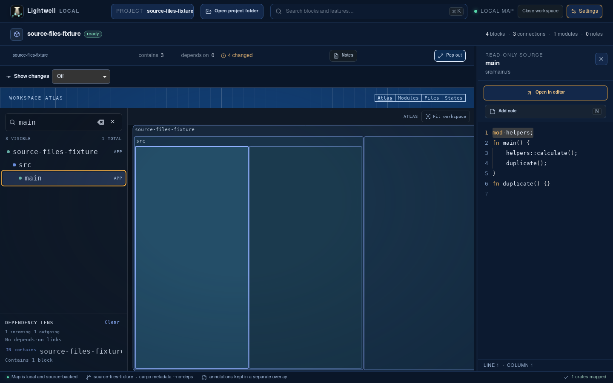
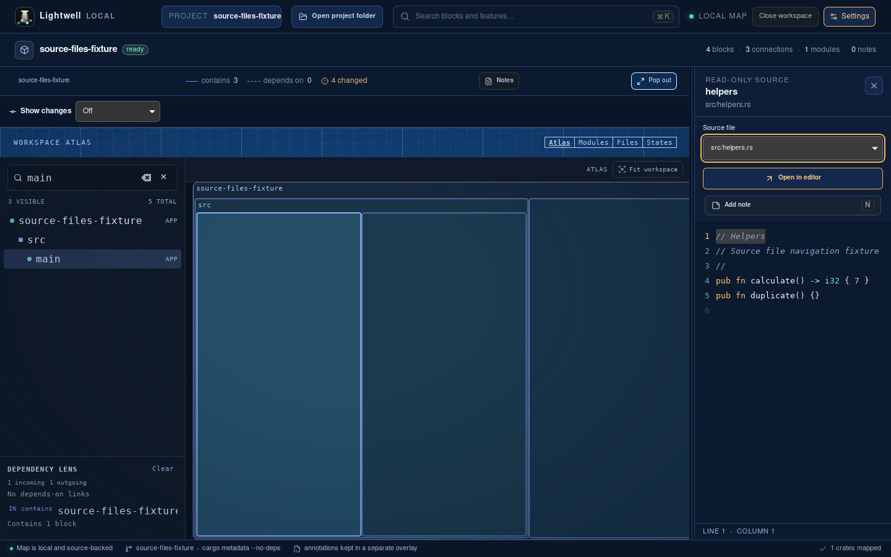
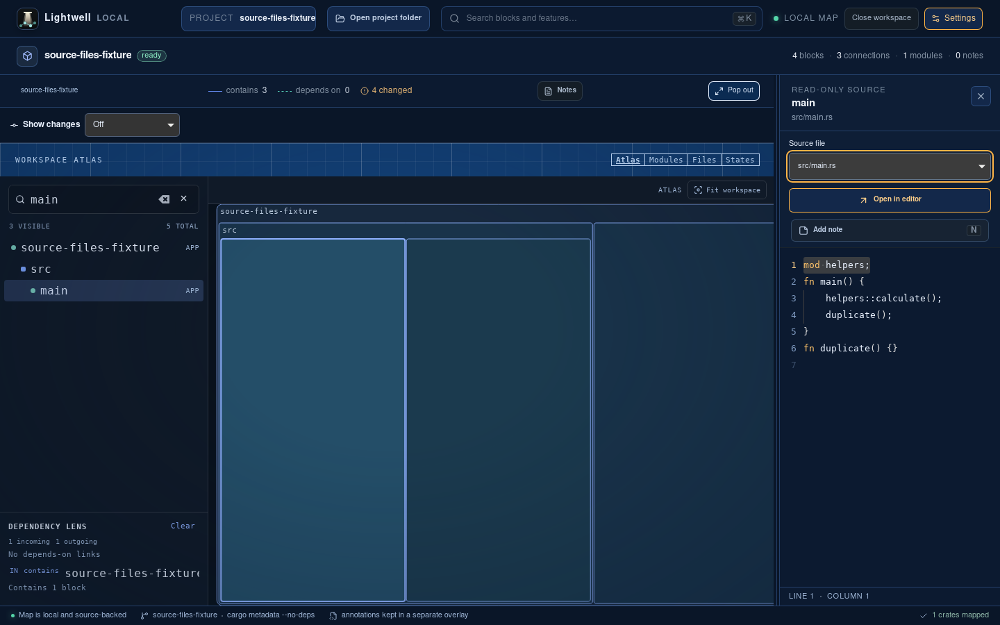

# Files in a block

The source inspector now offers a file selector for a block with multiple mapped files. A main app block can open its helper file and return to its primary source without leaving the inspector. External-editor and project-note actions use the displayed file's mapped block.

These unmodified screenshots come from real Tauri builds in a fresh Ubuntu VM. The baseline is `c83570c9ca398e2446982cdfe40c82e59a2d6c21`; the updated UI is `82142597b66a7d8cd754c16dff8b853fa405898c`.

| Before | Helper file selected | Returned to primary file |
| --- | --- | --- |
|  |  |  |

## Native commands and results

The VM uses Node.js 22, stable Rust, the Tauri Linux dependencies, Git, Xvfb, xdotool, ImageMagick and Tesseract. Source extraction, inspection and editor launch use the real backend. The editor probe records the actual file argument without launching another GUI app.

```sh
npm ci
scripts/verify/doctor.sh
npm run tauri:build -- --debug --no-bundle -- --locked
cp target/debug/lightwell /tmp/lightwell-desktop-proof
scripts/verify/capture-source-files.sh /tmp/lightwell-desktop-proof "$ARTIFACTS"
```

The baseline run adds `before` as the fourth argument and prints:

```text
Baseline has no block source-file selector.
```

The updated build prints:

```text
verify doctor: ok
Block source files switched main.rs -> helpers.rs -> main.rs; external editor received helpers.rs.
```

The native drive exposed a disabled placeholder that intercepted Home. The selector now contains only real choices when a file is selected. The capture waits for the native menu before sending keyboard input and checks the source text after each choice.

## Regression coverage

The combined symbol and file navigation branch passes 398 unit tests and 22 focused browser checks across desktop and narrow layouts. The checks cover unique file paths, excluded siblings, switching and returning, editor/note targets, normal-selection reset, closing/reopening, stale source responses, and definition-jump integration. The full browser suite contains 304 checks.

The selector uses mapped block IDs with the existing confined source resolver. This change adds no path-reading IPC, map schema fields or extractor behavior. Its list includes the opened block and mapped descendants. Dependencies and files absent from the map remain excluded. Commit diffs keep their existing single-file view.

The rerunnable [verification guide](../../../.cursor/skills/verify-lightwell/features/block-source-files.md) describes prerequisites and retained evidence. The helper removes its temporary app profile and fixture and stops its app/display. Export screenshots and logs before deleting the proof VM; raw editor-target logs contain a temporary absolute path and are excluded from public proof.
