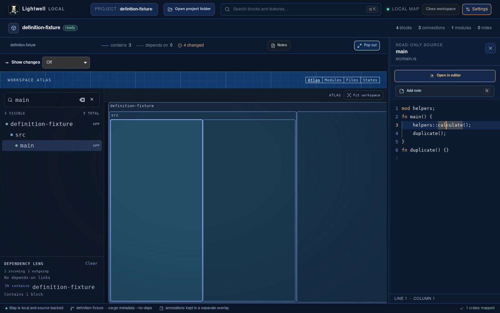
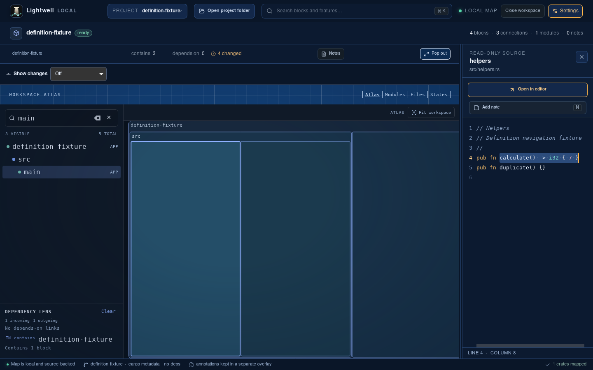
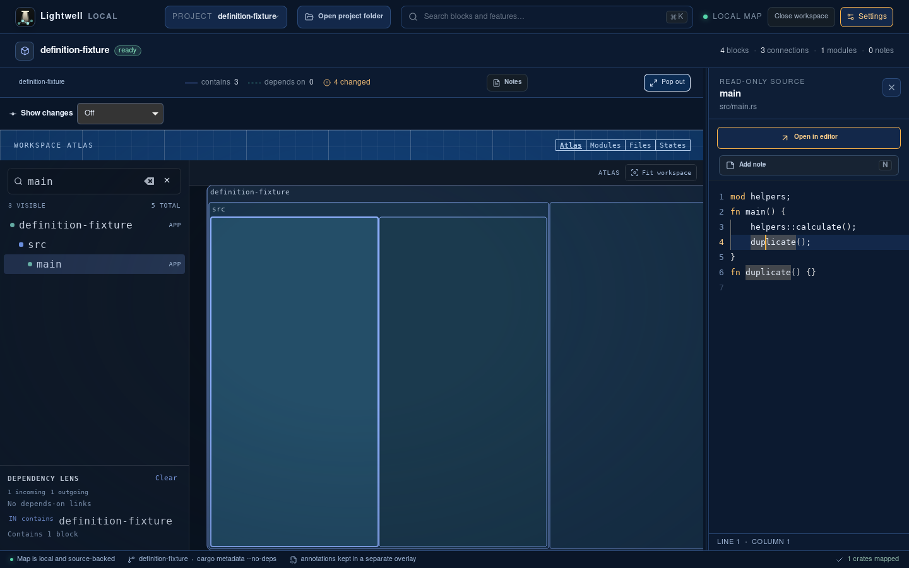

# Project symbol definition proof

F12 on `helpers::calculate()` now opens `src/helpers.rs` at line 4, column 8. The baseline keeps `src/main.rs` open. A name declared in both files leaves the caller open.

These unmodified screenshots come from real Tauri desktop builds in a fresh Ubuntu VM. The capture uses an isolated Rust workspace and app profile, native keyboard input, and the real extraction and definition commands. It does not mock IPC.

| Before, baseline `c83570c9ca398e2446982cdfe40c82e59a2d6c21` | After, implementation `c003c3e61af87b0cf4608c1927dd542023cb2864` |
| --- | --- |
|  |  |



## Desktop commands and output

The VM uses Node.js 22, stable Rust, the Tauri Linux dependencies, Xvfb, xdotool, ImageMagick and Tesseract. Both revisions use the same fixture and capture driver.

```sh
npm ci
scripts/verify/doctor.sh
npm run tauri:build -- --debug --no-bundle -- --locked
cp target/debug/lightwell /tmp/lightwell-desktop-proof
scripts/verify/capture-definitions.sh /tmp/lightwell-desktop-proof "$ARTIFACTS"
```

The baseline run adds `before` as the fourth argument. Its output is:

```text
Baseline F12 left the caller open.
```

The updated app prints:

```text
verify doctor: ok
Definition navigation opened helpers.rs at line 4 column 8; ambiguous name left main.rs open.
```

The driver waits for both the caller path and its source text before pressing F12. It stops its app and display, removes its temporary profile and fixture, and retains screenshots and OCR logs.

## Regression results

At implementation `c003c3e61af87b0cf4608c1927dd542023cb2864`:

| Command | Result |
| --- | --- |
| `npm test` | 396 passed |
| `cargo test -p lightwell-core --lib --locked` | 171 passed |
| `cargo test -p lightwell-app --bin lightwell --locked` | 29 passed, 1 ignored |
| `playwright test e2e/definitions.spec.ts` | 12 passed across desktop and narrow layouts |
| `npm run test:e2e` | 294 passed |
| Production TypeScript/Vite build | Passed |
| Scorecard configured secrets, tests, lint and types gates | Passed |

The same F12 and modifier-click browser checks against the baseline app both fail because the helper inspector never opens. The updated checks also cover module fallback, unknown and ambiguous names, map refresh, index reuse, normal-selection reset, and stale responses after selecting another or the same file.

This resolves unique declaration names among mapped source files. It does not perform compiler import, overload or type resolution. Built-in language parsers with line-only positions open the declaration line at column 1. Rust declarations use identifier positions converted to Monaco UTF-16 columns. Custom language packs retain module-label navigation. Switching among multiple files owned by one block remains separate work.
